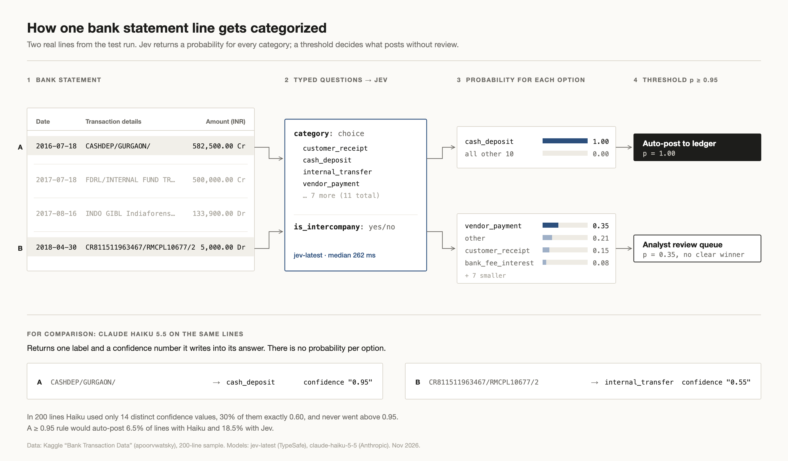

# Categorizing Bank Transactions: TypeSafe's Jev vs. Claude Haiku

*A small experiment on 200 bank statement lines, and what it says about which decisions in treasury you can safely automate*

---

Every treasury team runs the same tedious loop. Each morning, bank statements arrive with hundreds or thousands of lines like `TRF FROM Indiaforensic SERVICES` or `CR719811510098/RMCPL15265/1`. Someone has to decide what each line is: a customer payment, a vendor payment, a transfer between the company's own accounts, a bank fee. Until those labels exist, there's no reliable cash position, no forecast and no variance analysis.

This is a good job for AI, but not for the reason people usually give. The hard part isn't getting a model to produce a label, which any model can do. The hard part is knowing **which labels you can trust enough to post without a human checking them.**

I tested two very different approaches to this on the same data:

- **Claude Haiku 5.5**, Anthropic's small, fast general-purpose language model, with its output restricted to a fixed list of categories.
- **Jev**, from TypeSafe. It's built for exactly this kind of task: you give it data and a fixed set of possible answers, and it returns the answer with a probability for each option. TypeSafe describes it as a "smart if-statement".


*Two real lines from the test run. The cash deposit is posted automatically; the bare reference number goes to an analyst.*

## The Methodology

**Data.** I have used the public [Bank Transaction Data](https://www.kaggle.com/datasets/apoorvwatsky/bank-transaction-data) dataset on Kaggle: 116,201 lines from Indian corporate bank statements, with transaction details, deposit and withdrawal amounts, and cheque numbers. After removing lines with blank descriptions, 113,702 remained. I sampled 200 of them: half chosen so that as many different description formats as possible were represented, half at random.

```python
import kagglehub
path = kagglehub.dataset_download("apoorvwatsky/bank-transaction-data")
```

**Task.** Both models received exactly the same input: account, date, transaction details, whether money came in or went out, amount and cheque number. Both answered the same two questions:

1. Which of 11 cash-flow categories is this? The options were customer receipt, cash deposit, internal transfer, vendor payment, payroll, tax payment, bank fee/interest, loan/financing, refund/reversal, cash withdrawal, and other.
2. Is this a transfer between the company's own accounts or group entities (intercompany)?

**The Jev call** uses TypeSafe's System One API. A `choice` question returns a probability for every category, and a `noul` question returns the probability of "yes":

```python
body = {
    "model": "jev-latest",
    "state": transaction,  # plain dict of the statement line
    "questions": {
        "category": {"type": "choice",
                     "instructions": "Classify this bank statement line.",
                     "criteria": CATEGORIES},  # name -> description
        "is_intercompany": {"type": "noul",
                            "instructions": "Is this a transfer between own/group accounts?"},
    },
}
r = session.post("https://api.typesafe.ai/v1/systemone", json=body)
answer = r.json()["answers"]["category"]   # choice, confidence, probabilities
```

**The Haiku call** uses structured outputs, which guarantee the response matches a schema. The category is restricted to the same 11 values. The schema also has a `confidence` number field, and the system prompt asks the model to *"give your probability (0–1) that the chosen category is correct"*:

```python
resp = client.messages.create(
    model="claude-haiku-5-5",
    max_tokens=1024,
    system=SYSTEM_PROMPT,  # same category definitions
    messages=[{"role": "user", "content": json.dumps(transaction)}],
    output_config={"effort": "low",
                   "format": {"type": "json_schema", "schema": SCHEMA}},
)
# SCHEMA: {"category": enum of 11 values,
#          "confidence": number,
#          "is_intercompany": boolean}
```

> **How Haiku's "probability" is actually produced:** it isn't calculated. Haiku *writes* the confidence number as part of its answer, token by token, the same way it writes the category name. The number is the model's own estimate of how sure it is. It doesn't come from the model's internal probabilities, and the Claude API doesn't return those. So with Haiku you get one category and a self-reported score, not a probability for each of the 11 options.

Jev works differently. For a `choice` question, TypeSafe's API returns a probability for **every** option, summing to 1, plus a confidence score derived from how concentrated those probabilities are. That distinction drives most of the results below.

**No ground truth.** The dataset has no labels, so I couldn't measure true accuracy. I measured four things instead:

- **Accuracy on a rule-labeled subset.** These are 26 lines whose category is obvious from a keyword: `CASHDEP/…` is a cash deposit, `Sweep Trf` and `INTERNAL FUND TRANSFER` are internal transfers, `AEPS NPCI WDL` is a cash withdrawal. This is a sanity check, not a benchmark.
- **Agreement** between the two models.
- **Direction consistency.** A "customer receipt" on a debit line, or a "vendor payment" on a credit line, is wrong no matter what.
- **How many lines each model would auto-post** at a given confidence threshold.

## Results

**Speed**
- Jev: **262 ms** median, 341 ms at the 95th percentile
- Haiku: 948 ms median, 1,644 ms at the 95th percentile

**Cost per million transactions**
- Jev: **about $28** (about 670 input tokens per call; output is currently free)
- Haiku: about $106 (about 820 input and 45 output tokens per call)

**Accuracy on the 26 rule-labeled lines**
- Both: 100%. The easy cases are easy for both models.

**Labels that contradict whether money came in or went out**
- Jev: 0
- Haiku: 1

**Lines that could be auto-posted at ≥ 0.95 confidence**
- Jev: **18.5%** (37 of 200)
- Haiku: 6.5% (13 of 200)

**Agreement between the models**
- Same category: **50.5%**
- Same intercompany answer: 83%

Jev was about 3.6× faster and about 3.8× cheaper per transaction. Both passed the sanity checks. The big difference is in the last two results.

## Finding 1: Calibrated confidence is what lets you automate

What decides whether categorization can be automated is the confidence number, not the label.

Because Haiku writes its confidence as text, the numbers look like what a person would write, not like measured probabilities:

- **Only 14 distinct values across 200 answers**, almost all multiples of 0.05: 0.30, 0.35, 0.40 … 0.95. Jev produced **66 distinct values**.
- **59 of 200 answers (30%) were exactly 0.60.** That's the model's default "fairly sure" score, not a measurement.
- **It understates certainty even when it's right.** On the 26 easy lines both models got right, Haiku's confidence had a median of 0.94 and dropped as low as 0.85. Jev's had a median of 1.00 and never went below 0.96.
- **It tops out at 0.95.** Haiku never reported higher, so an auto-post rule of "≥ 0.95" catches only the 13 lines where it chose exactly its maximum.

A language model's self-reported confidence is a guess about its own answer, not a probability you can set a threshold on. You can make it more usable: ask the same question several times and use the share of matching answers (more calls, more cost), or map the scores to observed accuracy on labeled data. Both mean extra work that Jev's design does for you.

Jev returns a probability for every option, and the numbers behaved the way you'd want:

- **When Jev was confident, the models agreed.** On the 37 lines where Jev reached ≥ 0.95, Haiku gave the same category **97%** of the time.
- **When the models disagreed, Jev said it was unsure.** Median Jev confidence was **0.58 on disagreements** and 0.85 on agreements. Only 1% of disagreements reached 0.95.

So a simple rule, auto-post at ≥ 0.95 and route everything else to an analyst, would have automated almost one line in five here and kept the disputed lines away from automatic posting.

```python
if decision.category.p >= 0.95:
    auto_post(decision)
else:
    route_to_analyst(decision)
```

## Finding 2: Half of a raw bank statement is genuinely ambiguous

A 50% agreement rate sounds bad. Looking at the disagreements shows what's going on.

**Some lines carry no information at all.** `723620848723`, `IMPS 150118 3C` or `CR805013789150/RMCPL15896/1` can't be categorized from the text. The two models dealt with this differently:

- Haiku used "other" for 36 lines.
- Jev used "other" only 6 times. It fell back on direction instead, choosing customer receipt for credits and vendor payment for debits, at low confidence (often 0.3 to 0.4).

Neither answer is "right". The low confidence is the useful signal.

**Some lines need context the models don't have.** The account holder in this dataset appears to be "Indiaforensic Services". On lines like `TRF FROM Indiaforensic SERVICES` or `RTGS/SBINH…/Indfor`, Jev picked customer receipt and Haiku picked internal transfer. Haiku is probably right: money coming from your own entity is an intercompany transfer, not revenue. But nothing in the input told either model who "self" is.

**Some lines are ambiguous by definition.** Is `CHQ DEP/316498/…` a cash deposit or a customer receipt paid by cheque? That depends on your chart of accounts, not on the model.

## What I'd do in production

1. **Use the specialized model for the decisions, and a general LLM for writing.** Categorization, matching and exception routing are high-volume questions with fixed answers. That's what Jev is built for, and here it was faster, cheaper and better calibrated. Keep the general-purpose LLM for the parts that need written text, like the daily cash commentary.
2. **Add context before switching models.** Pass in the list of the company's own legal entities and bank accounts, and most of the "receipt vs. internal transfer" confusion disappears. Map recurring reference formats (like the `RMCPL` lines here) with deterministic rules.
3. **Let the threshold decide, and measure it.** Auto-post above the threshold, send the rest to an analyst, and check the threshold against transactions your analysts have already confirmed. Then adjust it.
4. **Ask small, separate questions.** "Category?", "Intercompany?" and "Anomalous?" as separate typed questions are easier to check, set thresholds on and audit than one "analyze this transaction" prompt.

## Caveats

- **200 lines from one public dataset**, from one account holder, with no ground truth. Read this as a directional result, not a benchmark.
- The rule-labeled subset only covers the easy cases, so 100% there doesn't say much about the hard ones.
- **Jev is in early access**, and it reads text and structured data only. Scanned remittances would need OCR first. TypeSafe's latency figures assume calls near their US West Coast servers; I didn't test from other regions.
- Haiku ran at low effort with a short prompt. More context or examples would probably improve its labels, but not make its self-reported confidence usable for thresholds.
- I estimated Jev's cost from TypeSafe's published price of $0.042 per million input tokens. My first rough guess, made before measuring the token count, was off by about 1,000×. Measure before you estimate.

## Takeaway

For treasury automation, "which model is smartest?" is the wrong question. The useful one is: **which model tells me when it doesn't know?** In this test, the model built to return typed answers with probabilities handled that better, at a quarter of the cost and a third of the response time. The ambiguous half of the statement still needs better context and a human, whichever model you use.

---

*The comparison script, prompts and category definitions are available on request. If you run this on your own labeled transactions, I'd like to hear whether the 0.95 threshold holds up.*
